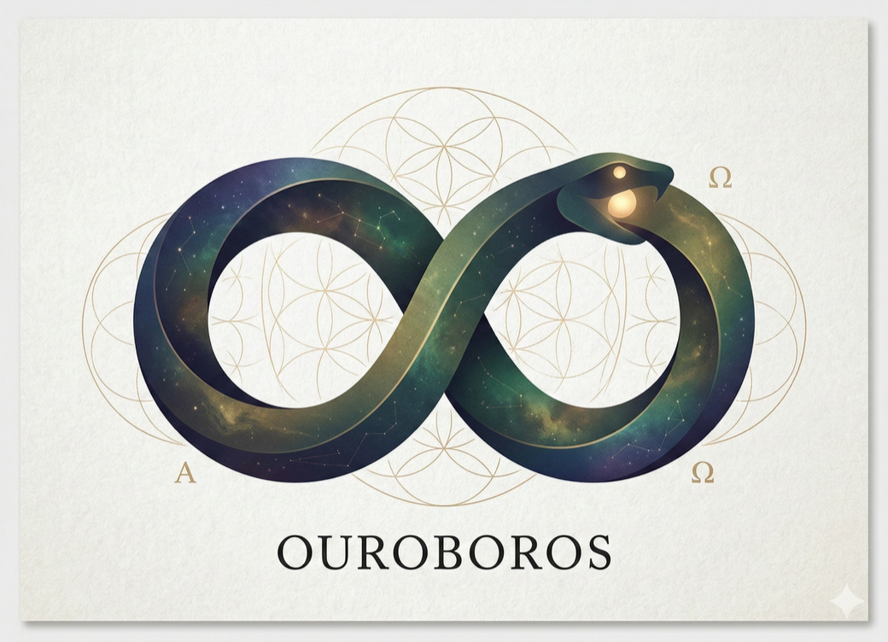
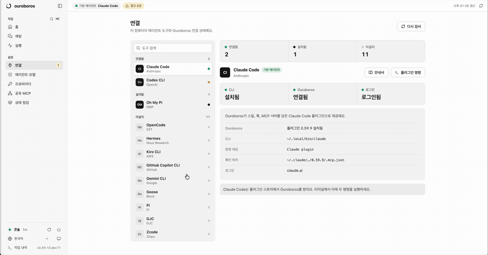

<p align="right">
  <a href="./README.md">English</a> | <strong>한국어</strong> | <a href="./README.zh-CN.md">简体中文</a>
</p>

<p align="center">
  <br/>
  ◯ ─────────── ◯
  <br/><br/>
  
  <br/><br/>
  <strong>O U R O B O R O S</strong>
  <br/><br/>
  ◯ ─────────── ◯
  <br/>
</p>


<p align="center">
  <strong>스스로 똑똑해지는 에이전트, 그 경계는 우리가 정합니다.</strong>
  <br/>
  <sub>먼저 묻고, 그다음 만들고, 언제나 확인합니다. 지금 쓰는 에이전트를 위한 명세 우선 AI 코딩.</sub>
</p>

<p align="center">
  <a href="https://github.com/Q00/ouroboros"></a>
  <a href="https://pypi.org/project/ouroboros-ai/"></a>
  <a href="https://github.com/Q00/ouroboros/actions/workflows/test.yml"></a>
  <a href="LICENSE"></a>
  <a href="https://github.com/sponsors/Q00"></a>
</p>

<p align="center">
  <a href="#설치">설치</a> ·
  <a href="#처음-해-볼-것">처음 해 볼 것</a> ·
  <a href="#지원-도구">지원 도구</a> ·
  <a href="#더-알아보기">더 알아보기</a> ·
  <a href="https://ouroboros.page/learn/">가이드</a>
</p>

Ouroboros는 AI 코딩 에이전트가 맞는 것을 만들도록 돕습니다. 목표가 분명해질
때까지 질문하고, 그 답을 확인 가능한 수용 기준이 담긴 스펙으로 정리한 뒤,
지금 쓰고 있는 코딩 에이전트에게 넘겨 만들게 하고, 결과가 스펙대로인지
검사합니다.

<p align="center">
  
</p>

<p align="center">
  <sub>Ouroboros 콘솔: 에이전트 도구 연결부터 채팅, 실행 기록, 모델 설정, 상태 점검까지 한곳에서 다룹니다.</sub>
</p>

## 설치

```bash
# macOS / Linux / WSL 2
curl -fsSL https://raw.githubusercontent.com/Q00/ouroboros/main/scripts/install.sh | OUROBOROS_INSTALL_REF=readme-ko bash
```

```powershell
# Windows (PowerShell) — Python 없어도 됩니다. Git과 uv를 대신 설치합니다
irm https://raw.githubusercontent.com/Q00/ouroboros/main/scripts/install.ps1 | iex
```

설치가 끝나면 브라우저에 Ouroboros 콘솔이 열리고, 에이전트 도구를 연결하는
과정을 차례로 안내합니다. 나중에 다시 열 때는 `ouroboros gui`를 실행하세요.

설치 스크립트는 이미 깔려 있는 에이전트 도구를 찾아 Ouroboros를 연결합니다.
네이티브 Windows는 실험 단계이고 Codex CLI는 WSL 2가 필요합니다.
[플랫폼 지원](./docs/platform-support.md)을 참고하세요.

**다른 설치 방법.** 아래 방법은 콘솔을 자동으로 열지 않습니다. `ouroboros`
명령이 설치된 뒤 `ouroboros gui`를 실행하세요.

```bash
# Claude Code 플러그인만 (설치 후 Claude Code 안에서 /ouroboros:setup 실행)
claude plugin marketplace add Q00/ouroboros && claude plugin install ouroboros@ouroboros

# pip / uv / pipx (Python 3.12+)
pip install 'ouroboros-ai[mcp,tui]' && ouroboros setup --runtime claude-cli

# Homebrew (macOS / Linux)
brew tap q00/tap && brew install ouroboros-ai && ouroboros setup
```

모든 설치 경로, 프로필, 호스트별 설정은 [시작 가이드](./docs/getting-started.md)(영어)에
있습니다. `ouroboros uninstall`은 Ouroboros 설정, MCP 등록, 데이터 디렉터리
(`~/.ouroboros/`)를 지웁니다. Python 패키지와 Claude Code 플러그인은 그대로 남으니,
[UNINSTALL.md](./UNINSTALL.md)에 있는 나머지 단계로 마저 제거하세요.

## 처음 해 볼 것

원하는 것을 평소 말투로 적으면 됩니다. 이렇게 시작해 보세요:

- **콘솔 채팅**: 목표를 적고 **인터뷰**(목표가 분명해질 때까지 질문) 또는 **자동**(빈 부분을 스스로 채움)을 고른 뒤, 스펙을 에이전트에게 넘기고 실행을 지켜보세요.
- 에이전트에서 **`ooo interview "마감일이 있는 할 일 CLI"`**: 목표가 분명해질 때까지 질문한 뒤 스펙(*Seed*)을 만듭니다.
- **`ooo auto "마감일이 있는 할 일 CLI"`**: 빠진 것만 묻고, 스펙을 쓰고, 실행하고, 검사합니다.
- **`ooo run`**: 이미 있는 Seed를 구현하고 모든 수용 기준을 검사합니다.

Claude Code에서는 `/ouroboros:setup`을 한 번 실행해 질문에 답한 뒤, 첫 `ooo`
명령은 다음 메시지로 따로 보내세요. 에이전트 호스트 없이 터미널에서는
`ouroboros init start "..."`와 `ouroboros auto "..."`로 같은 일을 할 수
있습니다. 전체 명령어 목록은 [시작 가이드](./docs/getting-started.md#commands)에
있습니다.

> Ouroboros가 실행하는 코딩 에이전트는 프로젝트 파일을 바꾸고 명령을 실행할 수
> 있습니다. 신뢰하지 않는 프로젝트에서 쓰기 전에
> [권한 범위](./skills/help/TROUBLESHOOTING.md#permission-scope)를 읽어 보세요.

## 지원 도구

[Claude Code](./docs/runtime-guides/claude-code.ko.md) ·
[Codex CLI](./docs/runtime-guides/codex.ko.md) ·
[GitHub Copilot CLI](./docs/runtime-guides/copilot.ko.md) ·
[OpenCode](./docs/runtime-guides/opencode.ko.md) ·
[Hermes](./docs/runtime-guides/hermes.ko.md) ·
[Gemini CLI](./docs/runtime-guides/gemini.ko.md) ·
[Kiro CLI](./docs/runtime-guides/kiro.ko.md) ·
[Pi](./docs/runtime-guides/pi.ko.md) ·
[OMP](./docs/runtime-guides/omp.ko.md) ·
[Zcode](./docs/runtime-guides/zcode.ko.md) ·
[Goose](./docs/runtime-guides/goose.ko.md) ·
[GJC](./docs/runtime-guides/gjc.ko.md) ·
[Antigravity CLI](./docs/runtime-guides/antigravity.ko.md) ·
[Grok Build CLI](./docs/runtime-guides/grok.ko.md) ·
[DeepSeek Harness](./docs/guides/deepseek-harness.md)

설치 스크립트는 이미 있는 도구를 연결하고, 나머지는 콘솔의 **연결** 화면에서
설치하고 연결할 수 있습니다. 먼저 보고 싶다면
[일곱 개 호스트에서 인터뷰가 돌아가는 모습](./docs/how-ouroboros-works.md#see-it-on-each-host)(영어 문서)을
확인하세요.

## 더 알아보기

- [시작 가이드](./docs/getting-started.md)(영어): 모든 설치 경로, 호스트별 설정, 첫 워크플로, 전체 명령어.
- [콘솔 가이드](./docs/guides/console.md)(영어): 콘솔 화면별 기능, 공유 MCP 서버, 로그인 시 콘솔 자동 시작.
- [Ouroboros 작동 방식](./docs/how-ouroboros-works.md)(영어): 순환 구조, 에이전트, 모호성 게이트, Agent OS 스택, 내부 구조, 철학.
- [TUI 사용 가이드](./docs/guides/tui-usage.ko.md): `ooo run`이나 `ooo evolve`를 실시간으로 지켜보는 터미널 대시보드.
- [CLI 레퍼런스](./docs/cli-reference.md) · [설정 레퍼런스](./docs/config-reference.md) · [플랫폼 지원](./docs/platform-support.md) · [전체 문서](./docs/README.md)
- [대화형 가이드](https://ouroboros.page/learn/)

<p align="center">
  <sub>대개는 리뷰 세 번째 파일쯤에서 자기가 명확하지 않았다는 걸 알게 됩니다.<br/>
  익숙한 기분이라면, 같은 일을 겪을 다음 사람이 이 프로젝트를 찾도록 <a href="https://github.com/Q00/ouroboros"><strong>GitHub의 Q00/ouroboros</strong></a>에 Star를 남겨 주세요.</sub>
</p>

## 기여하기

```bash
git clone https://github.com/Q00/ouroboros
cd ouroboros
uv sync --python 3.13 --all-groups
uv run --python 3.13 --no-sync pytest
```

[이슈](https://github.com/Q00/ouroboros/issues) · [토론](https://github.com/Q00/ouroboros/discussions) · [기여 가이드](./CONTRIBUTING.md)

## 후원하기

Ouroboros는 MIT 라이선스로 공개 개발되는 오픈소스입니다. 재작업을 줄여 줬다면
후원을 고려해 주세요. 후원금은 유지보수, 새로운 런타임 통합, 후원자 전용 심층
콘텐츠 제작에 쓰입니다.

<p align="center">
  <a href="https://github.com/sponsors/Q00"></a>
</p>

## 활동

여기 있는 숫자는 GitHub 데이터를 바탕으로 생성되어 자동으로 갱신되며, 캐시로 인해 업데이트가 지연될 수 있습니다.

<p align="center">
  <a href="https://github.com/Q00/ouroboros/graphs/contributors"></a>
  <a href="https://github.com/Q00/ouroboros/commits/main"></a>
  <a href="https://github.com/Q00/ouroboros/pulls?q=is%3Apr+is%3Aclosed"></a>
  <a href="https://github.com/Q00/ouroboros/commits/main"></a>
</p>

## 고지

> Ouroboros 프로젝트와 커뮤니티는 **어떤 암호화폐, 토큰, 밈코인, 트레이딩
> 커뮤니티와도 무관합니다** — pump.fun을 비롯한 런치패드에 올라온 "ouroboros"
> 티커도 여기 포함됩니다. 이것은 오픈소스 개발자 도구입니다. 우리는 어떤 코인도
> 발행하거나, 보증하거나, 보유하지 않습니다. 이 프로젝트와 관련이 있다고
> 주장하는 토큰은 전부 무단입니다.

> **이름 관련 안내.** "Ouroboros"라는 이름을 쓰는 별개의, 무관한 오픈소스
> 프로젝트가 하나 더 있습니다 — Anton Razzhigaev의 자가 수정형(self-modifying),
> 지속 기억형 에이전트(`github.com/razzant/ouroboros`)입니다. 코드 공유도,
> 관계도 없습니다. 이 프로젝트는 실행 전에 명세를 고정하며 스스로의 아키텍처를
> 다시 쓰지 않습니다 — 자기 자신의 코드를 고쳐 쓰는 에이전트를 찾으신다면
> 그쪽입니다.

---

<p align="center">
  <em>"시작이 곧 끝이고, 끝이 곧 시작이다."</em>
  <br/><br/>
  <strong>뱀은 반복하지 않는다 — 진화한다.</strong>
  <br/><br/>
  <code>MIT License</code>
</p>
