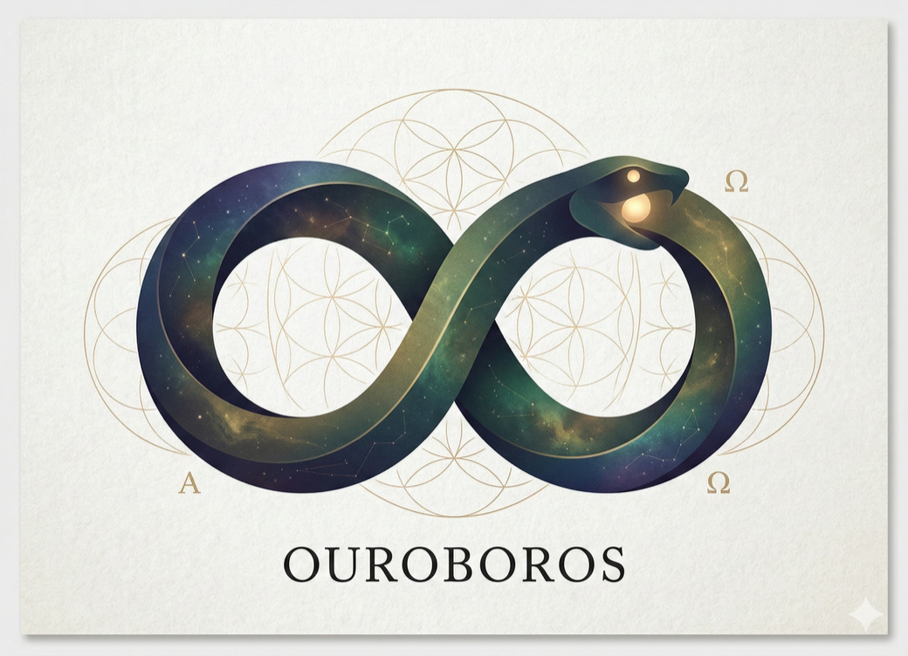

<!-- mcp-name: io.github.Q00/ouroboros -->
<p align="right">
  <strong>English</strong> | <a href="./README.ko.md">한국어</a> | <a href="./README.zh-CN.md">简体中文</a>
</p>

<p align="center">
  
</p>

# Ouroboros

**Clarify the goal. Build from a specification. Check the result.**

Ouroboros adds a specification-first workflow to your AI coding agent. An
interview exposes assumptions, a **Seed** records the goal and acceptance
criteria, and execution and evaluation produce evidence you can review. Use
it for a new project or a change to an existing codebase.

<p>
  <a href="https://pypi.org/project/ouroboros-ai/"></a>
  <a href="https://github.com/Q00/ouroboros/actions/workflows/test.yml"></a>
  <a href="LICENSE"></a>
</p>

[Quick start](#quick-start) · [Commands](#commands) ·
[Status and recovery](#status-and-recovery) · [Documentation](#find-your-next-step) ·
[English guide](https://ouroboros.page/learn/en/) ·
[한국어 가이드](https://ouroboros.page/learn/) · [中文指南](https://ouroboros.page/learn/zh/)

| What you have | Where to begin |
| :--- | :--- |
| An idea that still needs decisions | Follow the [first-task walkthrough](#quick-start). |
| An agreed goal, constraints, and completion criteria | Ask for `ooo seed` with that context, then review the specification. |
| An existing Seed | Open the target project and ask for `ooo run` with the Seed. |
| An existing repository | Read [brownfield guidance](./skills/brownfield/SKILL.md) before choosing the change. |

## Quick Start

This example follows one small goal: **a web app that adds tasks and marks them
complete**. It connects to the existing [step-by-step guide](https://ouroboros.page/learn/en/).
The questions and criteria below are illustrative, not captured output or a
promise that a run will pass.

### 1. Choose an installation

Have a signed-in coding agent and internet access ready. For a first exercise,
open a new project folder: execution can edit files, run commands, and call
models. Check the selected runtime's authentication, permissions, and billing;
Ouroboros does not include model usage. Installation and setup can also change
host configuration.

**Before choosing an installation:** some Codex execution paths can disable
both Codex approvals and its sandbox. A new project folder or worktree is not
OS-level isolation. Verify the independent OS, VM, or container file and
network boundaries first, and do not run an untrusted project or sensitive
environment until those boundaries are understood. `small` is a starting model
tier, not a spend or call limit; check provider pricing and budget controls.

<details>
<summary><strong>Permission paths, source, and model routing details</strong></summary>

Permission behavior is operation-specific: the fixed source selects
`bypassPermissions` for Codex Interview question generation when no mode is
supplied; the task runner and a cross-harness retry also request a
runtime-native bypass. Other adapter paths can use configured modes such as
`default` or `acceptEdits`, but the task runner can override an adapter's
existing mode, so a configured value is not a guarantee for every path. For
Codex, `bypassPermissions` maps to
`--dangerously-bypass-approvals-and-sandbox`, disabling both Codex approvals
and its sandbox for those execution paths. A permission-mode label does not
verify operating-system or container file and network isolation; check those
boundaries independently before running. See the [Interview permission
resolver](https://github.com/Q00/ouroboros/blob/592c667f076c3dad7ef68d7844e91480d80135d0/src/ouroboros/providers/factory.py#L113-L143),
[task-runner
override](https://github.com/Q00/ouroboros/blob/592c667f076c3dad7ef68d7844e91480d80135d0/src/ouroboros/orchestrator/runner.py#L5189-L5207),
[`bypassPermissions`
mapping](https://github.com/Q00/ouroboros/blob/592c667f076c3dad7ef68d7844e91480d80135d0/src/ouroboros/codex_permissions.py#L26-L50),
and [cross-harness
retry](https://github.com/Q00/ouroboros/blob/592c667f076c3dad7ef68d7844e91480d80135d0/src/ouroboros/orchestrator/parallel_executor.py#L7069-L7074)
in source `592c667f`.

Choosing `small` requests a frugal starting tier; actual routing depends on the
runtime, explicit model pins, available tier mappings, and execution path. If
the router is active, retries may raise the tier; evaluations or separate
workers may add calls. `small` is not a spend limit. See [tier
mapping](https://github.com/Q00/ouroboros/blob/592c667f076c3dad7ef68d7844e91480d80135d0/src/ouroboros/orchestrator/model_routing.py#L124-L161),
[router activation and explicit-pin
rules](https://github.com/Q00/ouroboros/blob/592c667f076c3dad7ef68d7844e91480d80135d0/src/ouroboros/orchestrator/model_routing.py#L381-L428),
and [retry escalation and native-support
gating](https://github.com/Q00/ouroboros/blob/592c667f076c3dad7ef68d7844e91480d80135d0/src/ouroboros/orchestrator/model_routing.py#L470-L541).

</details>

Usage telemetry is enabled by default; see [what is collected and how to opt
out](./TELEMETRY.md) before installation if you want to disable it.

| Path | Prerequisites | Where workflow commands go |
| :--- | :--- | :--- |
| Claude Code plugin | Claude Code and [uv](https://docs.astral.sh/uv/getting-started/installation/) on the host | A new Claude Code conversation |
| Codex plugin | Codex CLI and `uvx` (included with uv) on the host | A new Codex conversation |
| Standalone CLI | uv and an installed, authenticated runtime; Python 3.12+ for Ouroboros | Your terminal |

<details>
<summary><strong>Automated installation on macOS, Linux, or WSL 2</strong></summary>

For automatic host detection instead of choosing a plugin below, enter this
in a terminal. The script can install dependencies and configure detected
hosts; review the [installer](./scripts/install.sh) and its choices first.
Existing telemetry opt-out controls apply.

```bash
curl -fsSL https://raw.githubusercontent.com/Q00/ouroboros/main/scripts/install.sh | OUROBOROS_INSTALL_REF=readme-hero bash
```

Continue with a new host session and the first task below. Other installation
methods, including native Windows, are in the expandable section below.

</details>

**Claude Code — enter in a terminal:**

```bash
claude plugin marketplace add Q00/ouroboros
claude plugin install ouroboros@ouroboros
```

**Codex — enter in a terminal:**

```bash
codex plugin marketplace add Q00/ouroboros
codex plugin add ouroboros@ouroboros
```

Start a **new host session** after installing either plugin. If Ouroboros is
not available there, follow [installation troubleshooting](./docs/getting-started.md#troubleshooting)
before starting a task.

<details>
<summary><strong>Standalone CLI and other installation methods</strong></summary>

For a standalone installation with MCP 2 and the settings UI, enter in a
terminal. This example selects the Claude CLI runtime, which needs an installed
and authenticated `claude` command:

```bash
uv tool install --python 3.13 'ouroboros-ai[mcp,tui]'
ouroboros --version
ouroboros setup --runtime claude-cli
```

Use another compatible runtime from the [installation guide](./docs/getting-started.md#installation-details)
if needed. A base `pip install ouroboros-ai` in a Python 3.12+ environment is
also available for CLI workflows; optional backends and the settings UI have
separate extras. Host MCP registration needs an isolated launcher such as
`uvx` or `pipx`.

If you prefer pip, activate a separate Python 3.12+ virtual environment with
`uvx` or `pipx` available for host registration, then run the same MCP 2 and
settings-UI profile with an explicit Claude CLI worker:

```bash
pip install 'ouroboros-ai[mcp,tui]' && ouroboros setup --runtime claude-cli
```

MCP 2 (`[mcp]`) and the Claude Agent SDK profiles (`[claude]`, `[claude-sdk]`,
`[all]`) belong in separate environments. LiteLLM profiles need Python
3.12–3.13. See the [profile matrix](./docs/platform-support.md#python-profile-matrix)
before combining extras. The legacy `[dashboard]` extra is a compatibility
no-op.

The SDK-based `ouroboros-ai[claude]` profile is a separate installation choice;
see the [MCP and Claude profile matrix](./docs/platform-support.md#mcp-2-and-claude-package-profiles)
before selecting it.

The [installation guide](./docs/getting-started.md) also covers pip, source,
and automated installation. The scripts below download and execute an
installer, install dependencies, and configure detected hosts; review the
script and its choices before running it:

```bash
# macOS / Linux / WSL 2
curl -fsSL https://raw.githubusercontent.com/Q00/ouroboros/main/scripts/install.sh | OUROBOROS_INSTALL_REF=readme bash
```

```powershell
# Native Windows (experimental), PowerShell
irm https://raw.githubusercontent.com/Q00/ouroboros/main/scripts/install.ps1 | iex
```

The Windows script can install missing Git and uv through winget, and uv can
provide Python. Codex CLI uses WSL 2 under the current [platform support contract](./docs/platform-support.md).
Homebrew is another option through the project's own tap:

```bash
brew tap q00/tap
brew install ouroboros-ai
ouroboros setup
```

For removal, read [UNINSTALL.md](./UNINSTALL.md) before `ouroboros uninstall`;
uninstallation can remove configuration and stored data.

</details>

### 2. Discuss the goal and review the Seed

**Claude Code plugin — enter in the host conversation:**

```text
ooo setup
```

Answer the setup questions and finish setup before starting the Interview.

**Codex plugin:** In the new Codex session, check that the plugin is enabled and
its Ouroboros MCP tools are available. If they are missing, follow
[installation troubleshooting](./docs/getting-started.md#troubleshooting).
The `ooo setup` skill is for Claude Code; standalone CLI setup is a separate
terminal flow described above.

**Both plugin paths — enter in the host conversation:**

```text
ooo interview "Build a web app where I can add tasks and mark them complete. Include a README that explains prerequisites, how to install dependencies and run the app, the actual URL and port, how to stop it, and how to run the tests."
```

Answer the interview questions. For example, decide whether tasks should
survive a page refresh and whether completed tasks remain visible. When the
interview restates the agreed goal, confirm it, then ask:

```text
ooo seed
```

The current Interview skill proposes Seed generation after that confirmation;
an interview completion message alone does not establish that a Seed exists.
Read the resulting **Seed YAML**, including its goal, target project,
constraints, and testable acceptance criteria. Confirm the actual saved path
if you want to execute a file. If generation fails or no YAML is shown, resolve
that before running anything. See the [Interview](./skills/interview/SKILL.md)
and [Seed](./skills/seed/SKILL.md) skills for the version you are using.

**Standalone CLI users — enter in the project terminal instead:**

```bash
ouroboros init start "Build a web app where I can add tasks and mark them complete. Include a README that explains prerequisites, how to install dependencies and run the app, the actual URL and port, how to stop it, and how to run the tests."
```

The interactive CLI asks about generating the Seed and prints its saved path
on success. If it asks `Start workflow now?`, choose **No** to review the Seed
first; the source version's prompt defaults to Yes. Use the path actually
printed, rather than assuming a file was created.

For the example, acceptance criteria might require adding a task, marking it
complete, and retaining it after refresh **if that was agreed**. They can also
require a project README with prerequisites, dependency installation, app run
instructions, the actual URL and port, shutdown steps, and test commands.
Review and agree on these criteria before generating or running a Seed; they
are example requirements, not a complete executable Seed. The [Seed authoring
guide](./docs/guides/seed-authoring.md) explains the schema for manual authoring.

### 3. Run the specification and inspect the outcome

In the **host conversation**, ask for `ooo run` and provide the reviewed Seed
YAML or its actual file path. In a **terminal**, use
`ouroboros run <seed-file>` with the actual generated path; replace the
placeholder, including its angle brackets.

Execution may start as a background job. Save its returned IDs and read the
reported workspace: a job receipt does not prove completion, and an isolated
worktree should only be assumed when its path is actually reported. The
[run skill](./skills/run/SKILL.md) describes automatic evaluation and any
chained fix loop. Follow those jobs to their terminal results before starting
a duplicate run.

One worktree launch failure has a narrower cause: the standard MCP run tool
requests a worktree by default, and a Git repository created with `git init`
but no commit has no `HEAD` from which to create it ([MCP default](https://github.com/Q00/ouroboros/blob/592c667f076c3dad7ef68d7844e91480d80135d0/src/ouroboros/mcp/tools/execution_handlers.py#L1430), [worktree check](https://github.com/Q00/ouroboros/blob/592c667f076c3dad7ef68d7844e91480d80135d0/src/ouroboros/core/worktree.py#L371-L388)). In the project terminal, the read-only check `git rev-parse --verify HEAD` can confirm whether a commit exists. If it fails, review the repository and decide whether an initial commit is appropriate before retrying; do not let the tool create a commit or change project files for you. This finding is limited to the standard MCP worktree path; it does not establish behavior for non-Git projects, worktree-disabled runs, or OpenCode.

Review the outcome against the Seed:

1. Inspect the changed files in the reported project or worktree, including its
   README. If the README is missing or its dependency, run, URL/port, shutdown,
   or test instructions are unclear, ask the host to inspect the actual project
   and report verified details; do not guess commands or ports.
2. Read the tests, evaluation, and unresolved or unverified criteria.
3. Run the app. Add a task, mark it complete, and check persistence if the Seed
   requires it. Record the observed behavior rather than relying on a score.

If formal evaluation was not completed, request `ooo evaluate` with the actual
execution session ID and relevant artifacts **in a host conversation where the
Ouroboros evaluation skill is available**. Its product-managed evaluation
workflow uses Ouroboros MCP tools; if those tools are unavailable, follow only
the skill's documented fallback. `ooo evaluate` is not a standalone shell
command. For CLI-only use, check the installed
`ouroboros --help`; the cited [main CLI](https://github.com/Q00/ouroboros/blob/592c667f076c3dad7ef68d7844e91480d80135d0/src/ouroboros/cli/main.py)
and [0.59.9 CLI](https://github.com/Q00/ouroboros/blob/5f5fca90662861201ff0a26f502edd22b272c4c6/src/ouroboros/cli/main.py)
have no separate evaluation rerun command. For an MCP evaluation, when
`execution.auto_evolve` is enabled (on by default in those sources), a Seed is
available, and formal evaluation returns `final_approved: false`—including
`unverified`—Ouroboros can queue a bounded Ralph follow-up, adding model usage and file changes ([main
condition](https://github.com/Q00/ouroboros/blob/592c667f076c3dad7ef68d7844e91480d80135d0/src/ouroboros/mcp/tools/evaluation_job.py),
[0.59.9 condition](https://github.com/Q00/ouroboros/blob/5f5fca90662861201ff0a26f502edd22b272c4c6/src/ouroboros/mcp/tools/evaluation_job.py)).
To request evaluation without a new follow-up, ask the connected host to pass
`auto_evolve: false`. This applies to that evaluation request; it does not
cancel jobs already running.

If evaluation rejects the result, read the stage and failure reason before
fixing the work or revisiting the requirements. If acceptance is `unverified`,
check the configured tests, working directory, and execution evidence; add or
run the needed checks before evaluating again. The [evaluation skill](./skills/evaluate/SKILL.md)
describes the next action for each outcome; first check whether a follow-up job
is already running.

[Evaluation guidance](./docs/guides/evaluation-pipeline.md) ·
[Execution versus acceptance](./docs/guides/execution-vs-evaluation.md) ·
[Evaluation skill](./skills/evaluate/SKILL.md)

## Status and Recovery

An Interview session ID identifies the requirements conversation, not an
execution session or background job. If the Interview was interrupted, keep
its returned ID and continue it in the same host conversation and connected
server; continuing may call a model and update the saved interview state.
For a standalone CLI interview, `ouroboros init list` lists interview records;
if you used a custom directory, add `--state-dir <actual-directory>` to list
the same records. After checking the ID and target, use
`ouroboros init start --resume <interview-id>` in that environment, adding the
same `--state-dir` when needed. Resuming may call a model, update state, and
offer to generate a Seed or start a workflow; review each prompt. Host MCP
and CLI state locations may differ, so do not assume the CLI list includes a
host interview; matching locations may share records. Check the installed
version's help before acting.

Identify the ID type and active workspace before retrying. A background job,
execution session, execution aggregate, and Auto session are different things.
Use the commands supported by the installation that produced the ID:

| What you need | Host conversation | Terminal |
| :--- | :--- | :--- |
| Inspect an execution session | `ooo status <session-id>` | `ouroboros status run --session-id <session-id>` |
| Inspect an execution aggregate | Use the execution ID returned by the run | `ouroboros status execution <execution-id>` |
| Inspect a background job | Ask the assistant for that job's status and terminal result | `ouroboros job status <job-id>`, then `ouroboros job result <job-id>` when terminal |
| Find in-flight work | `ooo resume-session` | `ouroboros resume` |
| Stop work | `ooo cancel` with the identified target | See `ouroboros cancel --help` for the target type |

Replace placeholders with returned IDs. Do not use a job ID where a session
ID is required. If a connection closes, first check whether the worker is
still running and preserve its Seed, workspace, and state. A restart or a
saved record does not by itself resume a process. Follow the command returned
for the relevant workflow; recovery can restart work or consume more model
usage. See the [CLI reference](./docs/cli-reference.md),
[resume skill](./skills/resume-session/SKILL.md), and
[evolution recovery guide](./docs/guides/evolution-loop.md).

## Find Your Next Step

| Task | Documentation |
| :--- | :--- |
| Install, authenticate, or fix an MCP connection | [Getting started](./docs/getting-started.md) · [CLI diagnostics](./docs/cli-reference.md) · [`ooo help`](./skills/help/SKILL.md) |
| Choose a supported OS, Python profile, or runtime | [Platform support](./docs/platform-support.md) · [Runtime capability matrix](./docs/runtime-capability-matrix.md) · [Runtime guides](./docs/README.md#runtime-guides) |
| Refine an idea or work in an existing repository | [Interview](./skills/interview/SKILL.md) · [Brownfield](./skills/brownfield/SKILL.md) · [Auto](./skills/auto/SKILL.md) |
| Review or write a specification | [Seed skill](./skills/seed/SKILL.md) · [Seed YAML reference](./docs/guides/seed-authoring.md) |
| Check evidence or investigate a failed result | [Evaluation](./docs/guides/evaluation-pipeline.md) · [Execution versus evaluation](./docs/guides/execution-vs-evaluation.md) · [Safe but wrong output](./docs/guides/safe-but-wrong-output.md) |
| Configure models, limits, or integrations | [Configuration](./docs/config-reference.md) · [MCP API](./docs/api/mcp.md) · [Architecture](./docs/architecture.md) |
| Contribute or run local source | [Contributing](./CONTRIBUTING.md) · [Development setup](./docs/contributing/developing.md) |

The [documentation index](./docs/README.md) lists the full guides and API
references. The existing website provides a chapter-based tutorial in
[English](https://ouroboros.page/learn/en/), [한국어](https://ouroboros.page/learn/),
and [中文](https://ouroboros.page/learn/zh/); its displayed product version can
differ from the repository. Translations are maintained separately, so check
the page's version and the installed command help.

### Using these docs with an AI assistant

Start with the [documentation index](./docs/README.md) and the relevant
[`skills/`](./skills/) entrypoint. [`llms.txt`](./llms.txt) and
[`llms-full.txt`](./llms-full.txt) are repository discovery indexes; verify
workflow instructions against the relevant source skill and installed
version, especially where summaries differ. These links do not imply the
repository's complete documentation is installed with every host.

Give the assistant your goal, runtime, installation method, relevant IDs, and
an error excerpt with credentials removed. Ask it to identify the source and
version it actually read, separate suggested commands from actions it
performed, and report observed results and remaining uncertainty. For an
installed entrypoint, start with `ooo help`; host packaging and resource
discovery can differ. Do not supply API keys or a complete environment dump.

### Version and support scope

These workflow instructions were checked against product source
[`592c667f`](https://github.com/Q00/ouroboros/tree/592c667f076c3dad7ef68d7844e91480d80135d0)
on 2026-11-07. The published [v0.59.9 release](https://github.com/Q00/ouroboros/releases/tag/v0.59.9)
and a host's plugin skills or MCP process are separate version boundaries;
matching version labels alone do not establish matching source. The plugin
MCP descriptors in this source pin `ouroboros-ai[mcp]==0.59.9`. A terminal's
`ouroboros --version` describes that CLI installation, not every host-managed
server. Follow the installed help when it differs, and identify the mismatch
before applying a recovery procedure.

The first-task walkthrough has been checked against source, not executed
end to end with real models across every host. Current platform documentation
supports macOS, Linux, and WSL 2; native Windows remains experimental, and
Codex CLI uses WSL 2. See [platform support](./docs/platform-support.md) for
specific limitations. Model calls use the chosen host/provider's credentials
and billing. Setup may use that host's default model or configured role pins;
`ooo config` opens the settings flow when you want to review them. For install
telemetry and opt-out settings, see the [telemetry documentation](./TELEMETRY.md).

For legacy MCP installations older than 0.51.1, the known
[`Failed to reconnect` startup issue](https://github.com/Q00/ouroboros/issues/2012)
also matters; identify the package actually launched before updating it.

<details>
<summary><strong>Other runtimes, integration paths, and recordings</strong></summary>

Runtime capabilities and prerequisites vary. Choose the guide for your host:
[Claude Code](./docs/runtime-guides/claude-code.md) ·
[Codex CLI](./docs/runtime-guides/codex.md) · [Hermes](./docs/runtime-guides/hermes.md) ·
[OpenCode](./docs/runtime-guides/opencode.md) · [Kiro](./docs/runtime-guides/kiro.md) ·
[Gemini](./docs/runtime-guides/gemini.md) · [Copilot](./docs/runtime-guides/copilot.md) ·
[Zcode](./docs/runtime-guides/zcode.md) · [Pi JSON mode](https://pi.dev/docs/latest/json) ·
[OMP](./docs/runtime-guides/omp.md) · [Goose](./docs/runtime-guides/goose.md) ·
[GJC](./docs/runtime-guides/gjc.md) · [Antigravity](./docs/runtime-guides/antigravity.md) ·
[Grok](./docs/runtime-guides/grok.md) · [Megacode](./docs/runtime-guides/megacode.md).
Copilot live model discovery and its opt-in ACP transport are described in the
[Copilot guide](./docs/runtime-guides/copilot.md) and [ACP guide](./docs/runtime-guides/copilot-acp.md).

[DeepSeek Harness](./docs/guides/deepseek-harness.md) supports two directions:
use `dsh` for the interview/Seed/QA backend, or install the
[`dsh-ouroboros` plugin](./integrations/dsh-plugin) for `ooo` workflows inside a
dsh conversation. The guide covers the additional backend configuration.

Existing recordings show particular versions and environments, not supported
behavior for every installation:

- [CLI interview](./docs/images/7-ooo-interview-framed.gif)
- [ChatGPT integration](./docs/images/3-host-codex-framed.gif)
- [Claude Code interview](./docs/images/2-host-claude-framed.gif)
- [Hermes on Discord](./docs/images/5-host-hermes-framed.gif)
- [DeepSeek Harness](./docs/images/4-host-dsh-framed.gif)
- [Kiro CLI](./docs/images/6-host-kiro-framed.gif)
- [Antigravity](./docs/images/1-host-antigravity-framed.gif)
- [Setup refresh on one machine](./docs/images/ooo-setup-refresh.gif): the
  artifacts refreshed depend on the hosts actually installed there.

</details>

## Commands

Enter `ooo` phrases in a supported agent's **conversation**. Enter
`ouroboros` commands in a **terminal**. These are related entrypoints, not
interchangeable syntax or identical implementations.

| Host skill | Terminal entrypoint or reference | Purpose |
| :--- | :--- | :--- |
| `ooo setup` (Claude Code), `ooo config` | `ouroboros setup`, `ouroboros config` | Prepare the runtime and review settings |
| `ooo interview` | `ouroboros init start` | Clarify goal, constraints, and success |
| `ooo idk` | [Calibration contract](./docs/architecture.md#interview-calibration-control-turns) | Adjust interview explanations to your understanding |
| `ooo seed` | [Seed skill](./skills/seed/SKILL.md); CLI interview's generation step | Turn agreed requirements into a specification |
| `ooo auto` | `ouroboros auto` | Bounded interview, Seed repair, and execution handoff |
| `ooo run` | `ouroboros run <seed-file>` | Execute an existing specification |
| `ooo evaluate` | [Evaluation skill](./skills/evaluate/SKILL.md) / MCP | Evaluate an execution against its criteria |
| `ooo evolve`, `ooo ralph` | [Evolution and Ralph](./docs/guides/evolution-loop.md) / MCP | One evolutionary generation or a bounded loop |
| `ooo status` | `ouroboros status` | Inspect sessions and progress; the skill also supports drift |
| `ooo resume-session`, `ooo cancel` | `ouroboros resume`, `ouroboros cancel` | Find recovery commands or cancel the identified work |
| `ooo unstuck` | [Unstuck skill](./skills/unstuck/SKILL.md) / MCP | Examine a stuck problem from different perspectives |
| `ooo pm` | `ouroboros pm` | Product-focused interview and requirements |
| `ooo qa` | [QA skill](./skills/qa/SKILL.md) | Assess an artifact |
| `ooo brownfield` | [Brownfield skill](./skills/brownfield/SKILL.md) | Inspect an existing repository's context |
| `ooo publish` | [Publish skill](./skills/publish/SKILL.md), using `gh` | Publish Seed work as GitHub issues |
| `ooo update` | `ouroboros update` | Check and update an installation |
| `ooo tutorial`, `ooo help` | [Tutorial](./skills/tutorial/SKILL.md), `ouroboros --help` | Learn the workflow or find commands |

There is no direct CLI subcommand for every skill. `ooo idk` changes the active
interview's wording, preserves rigor, and must be applied again after reopening
a saved session. In Claude Code, `/resume` belongs to the host; use
`ooo resume-session` for Ouroboros. The safe direct slash forms for its
reserved names are `/ouroboros:ouroboros-run`, `/ouroboros:ouroboros-status`,
`/ouroboros:ouroboros-help`, and `/ouroboros:ouroboros-config`.

## Why Ouroboros?

A coding agent can implement an assumption nobody intended. Ouroboros makes
that assumption discussable before execution and records a contract for
checking the result. It is useful when requirements are unclear, scope keeps
moving, or a test pass alone does not answer whether the requested outcome
was delivered.

## What You Get

| Stage | Result to inspect |
| :--- | :--- |
| Interview | Decisions, unresolved assumptions, and an ambiguity assessment |
| Seed | Goal, constraints, ontology, and acceptance criteria in YAML |
| Execute | Changed artifacts, execution state, and recorded evidence |
| Evaluate | Executed checks, model feedback, and approved/rejected/unverified acceptance state |
| Evolve | A proposed next generation informed by evaluation |

Ambiguity and quality scores are model judgments. A passed score, stable
ontology, or completed process is not sufficient evidence that the result
works. Review the specification and observed behavior.

## The Loop

```text
Interview → Seed → Execute → Evaluate
    ↑                           ↓
    └────── Evolutionary Loop ──┘
```

The Seed records the agreed contract for a generation. Evaluation can inform a
new generation; compare proposed changes with the original goal.

<a id="ralph-the-loop-that-never-stops"></a>
<a id="ralph-a-bounded-evolutionary-loop"></a>

`ooo evolve` runs one generation, while `ooo ralph` starts a bounded background loop
(default 10 generations). Neither a job ID nor ontology convergence proves
acceptance. See [evolution and terminal outcomes](./docs/guides/evolution-loop.md)
and the [Ralph skill](./skills/ralph/SKILL.md).

## How It Compares

| Need | A direct coding-agent conversation | Ouroboros adds |
| :--- | :--- | :--- |
| Agree on intent | Depends on your prompts and process | Interview and an explicit Seed |
| Decide when requirements are clear | Depends on your process | An interview score gate with an explicit override, or structural checks for already-settled context |
| Check completion | Depends on the checks you arrange | Mechanical checks and model review against criteria |
| Iterate on failure | Depends on your process | Recorded lineage and bounded follow-up workflows |

## The Ouroboros Agent OS Stack

Ouroboros also supplies runtime, MCP, event-journal, and execution primitives
for a wider Agent OS stack. You can use this repository's workflow on its own.

| Layer | Project | Role |
| :--- | :--- | :--- |
| Core | [Q00/ouroboros](https://github.com/Q00/ouroboros) | Seed, ledger, runtime, MCP, and execution boundaries |
| Domain workflows | [Ouro-labs/ouroboros-plugins](https://github.com/Ouro-labs/ouroboros-plugins) | UserLevel plugins with scoped permissions and provenance |
| Terminal shell | [Ouro-labs/ourocode](https://github.com/Ouro-labs/ourocode) | A terminal UI for workflows, MCP state, and decisions |

See [architecture](./docs/architecture.md) for the core design and plugin contract.

## The Nine Minds

<details>
<summary><strong>Agent roles</strong></summary>

These nine roles illustrate the workflow. More specialist definitions are available in
[`src/ouroboros/agents/`](./src/ouroboros/agents/), loaded as needed:

| Agent                    | Role                               | Core Question                                       |
| :----------------------- | :--------------------------------- | :-------------------------------------------------- |
| **Socratic Interviewer** | Questions-only. Never builds.      | *"What are you assuming?"*                          |
| **Ontologist**           | Finds essence, not symptoms        | *"What IS this, really?"*                           |
| **Seed Architect**       | Crystallizes specs from dialogue   | *"Is this complete and unambiguous?"*               |
| **Evaluator**            | 3-stage verification               | *"Did we build the right thing?"*                   |
| **Contrarian**           | Challenges every assumption        | *"What if the opposite were true?"*                 |
| **Hacker**               | Finds unconventional paths         | *"What constraints are actually real?"*             |
| **Simplifier**           | Removes complexity                 | *"What's the simplest thing that could work?"*      |
| **Researcher**           | Stops coding, starts investigating | *"What evidence do we actually have?"*              |
| **Architect**            | Identifies structural causes       | *"If we started over, would we build it this way?"* |

</details>

## Under the Hood

<details>
<summary><strong>Architecture overview -- Python >= 3.12</strong></summary>

```
src/ouroboros/
+-- bigbang/        Interview, ambiguity scoring, brownfield explorer
+-- router/         Skill dispatch (`ooo <skill>` -> MCP tool); PAL tier routing is in orchestrator/
+-- execution/      (deprecated — logic moved to orchestrator/ and mcp/tools/)
+-- evaluation/     Mechanical -> Semantic -> Multi-Model Consensus
+-- evolution/      Wonder / Reflect cycle, convergence detection
+-- resilience/     4-pattern stagnation detection, 5 lateral personas
+-- observability/  3-component drift measurement, auto-retrospective
+-- persistence/    Event sourcing (SQLAlchemy + aiosqlite), checkpoints
+-- orchestrator/   Runtime abstraction layer (Claude Code, Codex CLI, OpenCode, Hermes, Gemini, Kiro, Copilot, Pi, OMP, GJC, Goose, Antigravity, Grok, Zcode)
+-- core/           Types, errors, seed, ontology, security
+-- providers/      LiteLLM multi-provider adapter
+-- mcp/            MCP client/server integration
+-- plugin/         Plugin system (skill/agent auto-discovery)
+-- tui/            Terminal UI dashboard
+-- cli/            Typer-based CLI
```

**Key internals:**
- **PAL Router** -- Frugal -> Standard -> Frontier, with escalation on retry. The tier cost weights (1x / 10x / 30x) are routing estimates, not a model-price guarantee.
- **Drift** -- Goal (50%) + Constraint (30%) + Ontology (20%) weighted measurement, threshold <= 0.3
- **Brownfield** -- Auto-detects config files across multiple language ecosystems
- **Evolution** -- Default limit of 30 generations; ontology similarity is one convergence signal
- **Stagnation** -- Detects spinning, oscillation, no-drift, and diminishing returns patterns
- **Agent OS runtime** -- Replayable execution contract across capability discovery, policy, directives, event journal, and agent processes
- **Runtime backends** -- The registry is the source of truth for every canonical backend returned by `runtime_backend_choices()`, including GJC, Antigravity, Grok, and Zcode. Select through `orchestrator.runtime_backend` and compare supported features in the [runtime capability matrix](./docs/runtime-capability-matrix.md); registered engines do not all have identical capabilities.

See [Architecture](./docs/architecture.md) for the full design document.

</details>

---

## From Wonder to Ontology

<details>
<summary><strong>The philosophical engine behind Ouroboros</strong></summary>

> *Wonder -> "How should I live?" -> "What IS 'live'?" -> Ontology*
> -- Socrates

Every great question leads to a deeper question -- and that deeper question is always **ontological**: not *"how do I do this?"* but *"what IS this, really?"*

```
   Wonder                          Ontology
"What do I want?"    ->    "What IS the thing I want?"
"Build a task CLI"   ->    "What IS a task? What IS priority?"
"Fix the auth bug"   ->    "Is this the root cause, or a symptom?"
```

This is not abstraction for its own sake. When you answer *"What IS a task?"* -- deletable or archivable? solo or team? -- you eliminate an entire class of rework. **The ontological question is the most practical question.**

Ouroboros embeds this into its architecture through the **Double Diamond**:

```
    * Wonder          * Design
   /  (diverge)      /  (diverge)
  /    explore      /    create
 /                 /
* ------------ * ------------ *
 \                 \
  \    define       \    deliver
   \  (converge)     \  (converge)
    * Ontology        * Evaluation
```

The first diamond is **Socratic**: diverge into questions, then converge on a clearer understanding. The second is **pragmatic**: explore design options, then evaluate delivery. This is a way to understand the design, not a mandatory sequence for every task. If the goal, constraints, and success criteria are already settled, you can create a Seed from that agreement; if you already have a Seed, you can start with `ooo run`. In either case, review the Seed and its fit to the original request before execution.

</details>

<details>
<summary><strong>Ambiguity Score: The Gate Between Wonder and Code</strong></summary>

The interview uses a score to make remaining ambiguity visible. Ouroboros computes ambiguity as the inverse of weighted clarity:

```
Ambiguity = 1 - Sum(clarity_i * weight_i)
```

Each dimension is assessed on a 0.0-1.0 scale by a model, then weighted. These are judgments, not measured probabilities, and scores can vary:

| Dimension                                                     | Greenfield | Brownfield |
| :------------------------------------------------------------ | :--------: | :--------: |
| **Goal Clarity** -- *Is the goal specific?*                   |    40%     |    35%     |
| **Constraint Clarity** -- *Are limitations defined?*          |    30%     |    25%     |
| **Success Criteria** -- *Are outcomes measurable?*            |    30%     |    25%     |
| **Context Clarity** -- *Is the existing codebase understood?* |     --     |    15%     |

**Interview-based generation:** the first-generation Seed generator uses an
overall ambiguity threshold of **0.2 or less** by default. CLI `init` also
checks per-dimension clarity floors. When the CLI requirements do not qualify,
it offers continuing the interview, generating anyway with an explicit force
choice, or cancelling. Force does not remove the remaining Seed validation.

This score is not required by every Seed path. For already-agreed
`session_context`, the MCP tool checks structural completeness and asks for
missing requirements without running a scored interview. Without MCP, the
Seed skill can draft from recovered requirements without requiring an
ambiguity score. See the [Seed skill's generation paths](./skills/seed/SKILL.md).

```
Example (Greenfield):

  Goal: 0.9 * 0.4  = 0.36
  Constraint: 0.8 * 0.3  = 0.24
  Success: 0.7 * 0.3  = 0.21
                        ------
  Clarity             = 0.81
  Ambiguity = 1 - 0.81 = 0.19  <= 0.2 -> Overall threshold met
```

This calculation meets the overall threshold; CLI dimension floors and Seed
validation are separate checks. A qualifying score does not guarantee
correctness. Review the Seed whichever generation path you use.

</details>

<details>
<summary><strong>Ontology Convergence: When the Serpent Stops</strong></summary>

The evolutionary loop uses ontology similarity as one signal that a design
has stabilized. Its default similarity threshold is 0.95, and its convergence
checker also considers stagnation, oscillation, and a generation limit. The
default evolution limit is 30; the separate Ralph loop defaults to 10.

Stability is not the same as a successful outcome: execution mode also needs
acceptance evidence. A generation may stop with `ontology_stable`,
`stagnated`, `exhausted`, or an error instead of `converged`. Read the actual
action and evaluation, and compare the result with the original request. See
the [evolution guide](./docs/guides/evolution-loop.md) and
[convergence implementation](./src/ouroboros/evolution/convergence.py).
</details>

---

## Contributing

```bash
git clone https://github.com/Q00/ouroboros
cd ouroboros
uv sync --python 3.13 --all-groups
uv run --python 3.13 --no-sync pytest
```

[Issues](https://github.com/Q00/ouroboros/issues) · [Discussions](https://github.com/Q00/ouroboros/discussions) · [Contributing Guide](./CONTRIBUTING.md)

---

## Sponsors

Ouroboros is MIT-licensed and built in the open. If it saves you rework — or you want the loop to keep evolving — consider sponsoring. Sponsorship directly funds maintenance, new runtime integrations, and sponsor-only deep-dive content.

<p align="center">
  <a href="https://github.com/sponsors/Q00"></a>
</p>

Every sponsor keeps the serpent evolving. Thank you.

---

## Activity

These numbers are generated from GitHub data and refreshed automatically; caching may delay updates.

<p align="center">
  <a href="https://github.com/Q00/ouroboros/graphs/contributors"></a>
  <a href="https://github.com/Q00/ouroboros/commits/main"></a>
  <a href="https://github.com/Q00/ouroboros/pulls?q=is%3Apr+is%3Aclosed"></a>
  <a href="https://github.com/Q00/ouroboros/commits/main"></a>
</p>

---

<p align="center">
  <em>"The beginning is the end, and the end is the beginning."</em>
  <br/><br/>
  <strong>The serpent does not repeat -- it evolves.</strong>
  <br/><br/>
  <code>MIT License</code>
</p>


### Project identity

This project and community are not affiliated with any cryptocurrency, token,
memecoin, or trading community. We do not issue or endorse coins; tokens
claiming association are unauthorized.

A separate, unaffiliated project also uses the name “Ouroboros”: Anton
Razzhigaev's self-modifying agent at `github.com/razzant/ouroboros`. It has no
shared code or relationship with this project.
