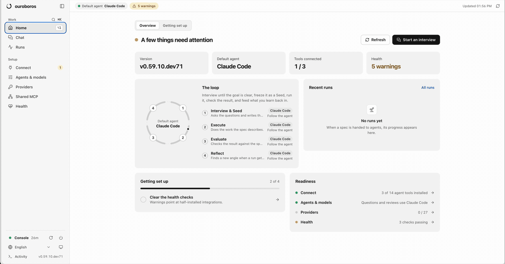

<!-- mcp-name: io.github.Q00/ouroboros -->
<p align="right">
  <strong>English</strong> | <a href="./README.ko.md">한국어</a> | <a href="./README.zh-CN.md">简体中文</a>
</p>

<p align="center">
  <br/>
  ◯ ─────────── ◯
  <br/><br/>
  
  <br/><br/>
  <strong>O U R O B O R O S</strong>
  <br/><br/>
  ◯ ─────────── ◯
  <br/>
</p>


<p align="center">
  <strong>It gets smarter on its own. We just hold the line.</strong>
  <br/>
  <sub>Ask first, build second, check always: spec-first AI coding for the agents you already use.</sub>
</p>

<p align="center">
  <a href="https://github.com/Q00/ouroboros"></a>
  <a href="https://pypi.org/project/ouroboros-ai/"></a>
  <a href="https://github.com/Q00/ouroboros/actions/workflows/test.yml"></a>
  <a href="LICENSE"></a>
  <a href="https://github.com/sponsors/Q00"></a>
</p>

<p align="center">
  <a href="https://trendshift.io/repositories/26008?utm_source=repository-badge&utm_medium=badge&utm_campaign=badge-repository-26008" target="_blank" rel="noopener noreferrer"></a>
</p>

<p align="center">
  <a href="#install">Install</a> ·
  <a href="#first-steps">First steps</a> ·
  <a href="#works-with">Works with</a> ·
  <a href="#learn-more">Learn more</a> ·
  <a href="https://ouroboros.page/learn/en/">Guide</a>
</p>

Ouroboros helps your AI coding agent build the right thing. It asks you
questions until the goal is clear, writes the answer down as a spec with
checkable acceptance criteria, hands that spec to the coding agent you already
use, and then checks the result against the spec.

<p align="center">
  
</p>

<p align="center">
  <sub>The Ouroboros console: type what you want in Chat, and it runs the interview, the spec, the build and the checks for you.</sub>
</p>

## Install

```bash
# macOS / Linux / WSL 2
curl -fsSL https://raw.githubusercontent.com/Q00/ouroboros/main/scripts/install.sh | OUROBOROS_INSTALL_REF=readme bash
```

```powershell
# Windows (PowerShell) — no Python needed; installs Git and uv for you
irm https://raw.githubusercontent.com/Q00/ouroboros/main/scripts/install.ps1 | iex
```

When installation finishes, the Ouroboros console opens in your browser and
walks you through connecting your agent tools. Reopen it any time with
`ouroboros gui`.

The installer finds the agent tools you already have and connects Ouroboros to
them. Native Windows is experimental, and Codex CLI needs WSL 2; see
[platform support](./docs/platform-support.md).

**Other ways to install.** These don't open the console for you; run
`ouroboros gui` once the `ouroboros` command is installed.

```bash
# Claude Code plugin only (then run /ouroboros:setup inside Claude Code)
claude plugin marketplace add Q00/ouroboros && claude plugin install ouroboros@ouroboros

# pip / uv / pipx (Python 3.12+)
pip install 'ouroboros-ai[mcp,tui]' && ouroboros setup --runtime claude-cli

# Homebrew (macOS / Linux)
brew tap q00/tap && brew install ouroboros-ai && ouroboros setup
```

Every install path, profile and host is in
[Getting Started](./docs/getting-started.md). `ouroboros uninstall` removes
Ouroboros's configuration, MCP registrations and data directory
(`~/.ouroboros/`). It leaves the Python package and the Claude Code plugin
installed; finish with the steps in [UNINSTALL.md](./UNINSTALL.md).

## First steps

Describe what you want in plain words. Four good places to start:

- **Console Chat**: type a goal and pick **Interview** (it asks until the goal is clear) or **Auto** (it fills the gaps itself), then hand the spec to your agents and watch the run.
- **`ooo interview "a todo CLI with due dates"`** in your agent: questions until the goal is clear, then a spec (a *Seed*).
- **`ooo auto "a todo CLI with due dates"`**: asks only what is missing, writes the spec, runs it, and checks it.
- **`ooo run`**: builds an existing Seed and checks every acceptance criterion.

In Claude Code, run `/ouroboros:setup` once and finish its questions, then send
your first `ooo` command as a separate message. From a plain terminal,
`ouroboros init start "..."` and `ouroboros auto "..."` do the same without an
agent host. The full command list is in
[Getting Started](./docs/getting-started.md#commands).

> Ouroboros runs coding agents that can change files and run commands in your
> project. Read [permission scope](./skills/help/TROUBLESHOOTING.md#permission-scope)
> before using it on a project you don't trust.

## Works with

[Claude Code](./docs/runtime-guides/claude-code.md) ·
[Codex CLI](./docs/runtime-guides/codex.md) ·
[GitHub Copilot CLI](./docs/runtime-guides/copilot.md) ·
[OpenCode](./docs/runtime-guides/opencode.md) ·
[Hermes](./docs/runtime-guides/hermes.md) ·
[Gemini CLI](./docs/runtime-guides/gemini.md) ·
[Kiro CLI](./docs/runtime-guides/kiro.md) ·
[Pi](./docs/runtime-guides/pi.md) ·
[OMP](./docs/runtime-guides/omp.md) ·
[Zcode](./docs/runtime-guides/zcode.md) ·
[Goose](./docs/runtime-guides/goose.md) ·
[GJC](./docs/runtime-guides/gjc.md) ·
[Antigravity CLI](./docs/runtime-guides/antigravity.md) ·
[Grok Build CLI](./docs/runtime-guides/grok.md) ·
[DeepSeek Harness](./docs/guides/deepseek-harness.md)

The installer connects the ones you have; the console's **Connect** page
installs and connects the rest. Want to see it first?
[Watch the interview run on seven different hosts](./docs/how-ouroboros-works.md#see-it-on-each-host).

## Learn more

- [Getting Started](./docs/getting-started.md): every install path, host-by-host setup, your first workflow, and all commands.
- [Console guide](./docs/guides/console.md): what each console page does, the shared MCP server, and starting the console at login.
- [How Ouroboros works](./docs/how-ouroboros-works.md): the loop, the agents, the ambiguity gate, the Agent OS stack, architecture, and philosophy.
- [CLI reference](./docs/cli-reference.md) · [Configuration](./docs/config-reference.md) · [Platform support](./docs/platform-support.md) · [All docs](./docs/README.md)
- [Interactive guide](https://ouroboros.page/learn/en/)

<p align="center">
  <sub>Most people find out they were unclear about three files into the review.<br/>
  If that feels familiar, star <a href="https://github.com/Q00/ouroboros"><strong>Q00/ouroboros on GitHub</strong></a> so the next person it could save can find it.</sub>
</p>

## Contributing

```bash
git clone https://github.com/Q00/ouroboros
cd ouroboros
uv sync --python 3.13 --all-groups
uv run --python 3.13 --no-sync pytest
```

[Issues](https://github.com/Q00/ouroboros/issues) · [Discussions](https://github.com/Q00/ouroboros/discussions) · [Contributing Guide](./CONTRIBUTING.md)

## Sponsors

Ouroboros is MIT-licensed and built in the open. If it saves you rework, consider
sponsoring: it funds maintenance, new runtime integrations, and sponsor-only
deep-dive content.

<p align="center">
  <a href="https://github.com/sponsors/Q00"></a>
</p>

## Activity

These numbers are generated from GitHub data and refreshed automatically; caching may delay updates.

<p align="center">
  <a href="https://github.com/Q00/ouroboros/graphs/contributors"></a>
  <a href="https://github.com/Q00/ouroboros/commits/main"></a>
  <a href="https://github.com/Q00/ouroboros/pulls?q=is%3Apr+is%3Aclosed"></a>
  <a href="https://github.com/Q00/ouroboros/commits/main"></a>
</p>

## Disclaimer

> The Ouroboros project and community are **not affiliated with any
> cryptocurrency, token, memecoin, or trading community** — including, but not
> limited to, any "ouroboros" tickers on pump.fun or other launchpads. This is
> an open-source developer tool. We do not issue, endorse, or hold any coins.
> Any token claiming association with this project is unauthorized.

> **Naming note.** A separate, unaffiliated open-source project also uses the
> name "Ouroboros" — Anton Razzhigaev's self-modifying, autonomous-memory agent
> at `github.com/razzant/ouroboros`. No shared code, no relationship. This
> project locks a specification before executing rather than rewriting its own
> architecture; if you're looking for the latter, that's the other one.

---

<p align="center">
  <em>"The beginning is the end, and the end is the beginning."</em>
  <br/><br/>
  <strong>The serpent does not repeat -- it evolves.</strong>
  <br/><br/>
  <code>MIT License</code>
</p>
