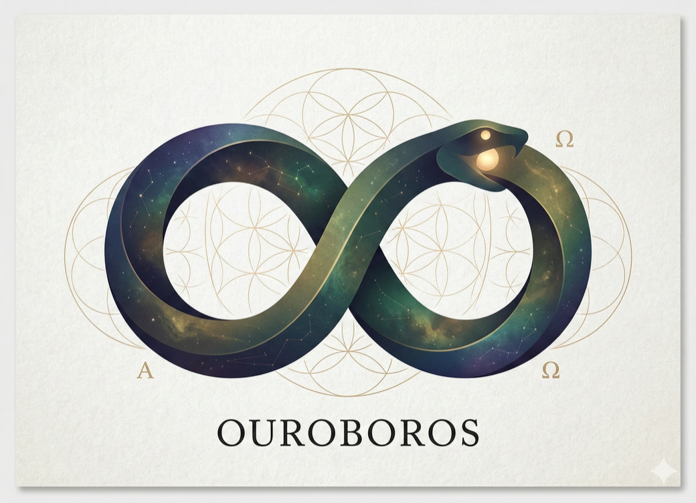
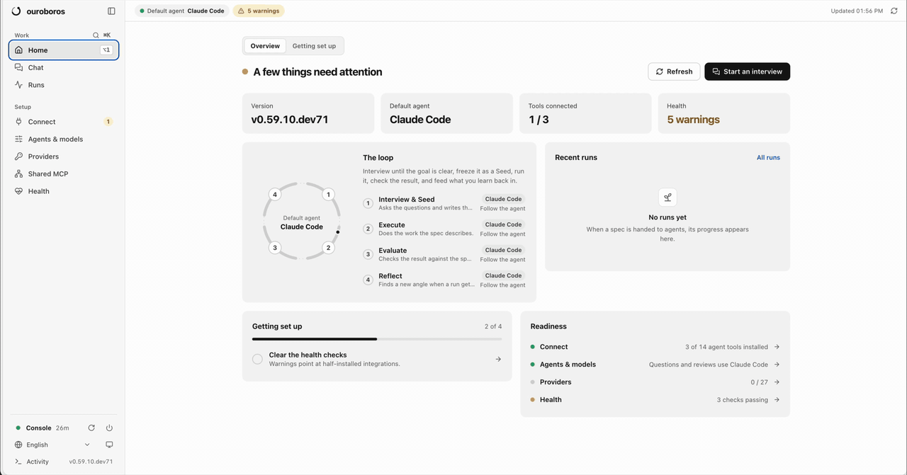

<p align="right">
  <a href="./README.md">English</a> | <a href="./README.ko.md">한국어</a> | <strong>简体中文</strong>
</p>

<p align="center">
  <br/>
  ◯ ─────────── ◯
  <br/><br/>
  
  <br/><br/>
  <strong>O U R O B O R O S</strong>
  <br/><br/>
  ◯ ─────────── ◯
  <br/>
</p>


<p align="center">
  <strong>让 Agent 自己变聪明，边界由我们来划定。</strong>
  <br/>
  <sub>先问清楚，再动手，始终检查：为你正在用的 agent 打造的规约优先 AI 编码。</sub>
</p>

<p align="center">
  <a href="https://github.com/Q00/ouroboros"></a>
  <a href="https://pypi.org/project/ouroboros-ai/"></a>
  <a href="https://github.com/Q00/ouroboros/actions/workflows/test.yml"></a>
  <a href="LICENSE"></a>
  <a href="https://github.com/sponsors/Q00"></a>
</p>

<p align="center">
  <a href="https://trendshift.io/repositories/26008?utm_source=repository-badge&utm_medium=badge&utm_campaign=badge-repository-26008" target="_blank" rel="noopener noreferrer"></a>
</p>

<p align="center">
  <a href="#安装">安装</a> ·
  <a href="#第一步">第一步</a> ·
  <a href="#支持的工具">支持的工具</a> ·
  <a href="#了解更多">了解更多</a> ·
  <a href="https://ouroboros.page/learn/zh/">指南</a>
</p>

Ouroboros 帮你的 AI 编码 agent 做出真正该做的东西。它会不断提问，直到目标清晰；把答案写成带有可检验验收标准的规约；交给你正在用的编码 agent 去实现；最后对照规约检查结果。

<p align="center">
  
</p>

<p align="center">
  <sub>Ouroboros 控制台：在 Chat 里写下你想要的东西，访谈、规约、实现和检查都会替你跑完。</sub>
</p>

## 安装

```bash
# macOS / Linux / WSL 2
curl -fsSL https://raw.githubusercontent.com/Q00/ouroboros/main/scripts/install.sh | OUROBOROS_INSTALL_REF=readme-zh bash
```

```powershell
# Windows (PowerShell) — 无需 Python；会自动安装 Git 和 uv
irm https://raw.githubusercontent.com/Q00/ouroboros/main/scripts/install.ps1 | iex
```

安装完成后，Ouroboros 控制台会在浏览器中打开，一步步引导你连接 agent 工具。之后随时可以用 `ouroboros gui` 重新打开。

安装程序会找到你已经装好的 agent 工具，并把 Ouroboros 接入它们。原生 Windows 仍是实验性支持，Codex CLI 需要 WSL 2，详见[平台支持](./docs/platform-support.md)。

**其他安装方式。** 这些方式不会自动打开控制台；装好 `ouroboros` 命令后运行 `ouroboros gui` 即可。

```bash
# 仅安装 Claude Code 插件（之后在 Claude Code 中运行 /ouroboros:setup）
claude plugin marketplace add Q00/ouroboros && claude plugin install ouroboros@ouroboros

# pip / uv / pipx（Python 3.12+）
pip install 'ouroboros-ai[mcp,tui]' && ouroboros setup --runtime claude-cli

# Homebrew（macOS / Linux）
brew tap q00/tap && brew install ouroboros-ai && ouroboros setup
```

所有安装方式、profile 和各宿主的设置都在[入门指南](./docs/getting-started.md)（英文）。`ouroboros uninstall` 会删除 Ouroboros 的配置、MCP 注册和数据目录（`~/.ouroboros/`），但 Python 包和 Claude Code 插件仍会保留，请再按 [UNINSTALL.md](./UNINSTALL.md) 中的其余步骤移除。

## 第一步

用平常的话描述你想要什么。可以从这四处开始：

- **控制台 Chat**：写下目标，选择 **Interview**（一直追问到目标清晰）或 **Auto**（自己补齐空白），然后把规约交给 agent，实时查看运行。
- 在你的 agent 里用 **`ooo interview "带截止日期的待办 CLI"`**：一直提问到目标清晰，然后生成规约（*Seed*）。
- **`ooo auto "带截止日期的待办 CLI"`**：只问缺少的信息，写好规约，执行并检查。
- **`ooo run`**：实现已有的 Seed，并逐条检查验收标准。

在 Claude Code 中，先运行一次 `/ouroboros:setup` 并回答完它的问题，再用下一条消息单独发送第一个 `ooo` 命令。不经过 agent 宿主、直接在终端里，`ouroboros init start "..."` 和 `ouroboros auto "..."` 也能做同样的事。完整命令列表见[入门指南](./docs/getting-started.md#commands)。

> Ouroboros 运行的编码 agent 可以修改项目文件、执行命令。在不可信的项目上使用之前，请先阅读[权限范围](./skills/help/TROUBLESHOOTING.md#permission-scope)。

## 支持的工具

[Claude Code](./docs/runtime-guides/claude-code.md) ·
[Codex CLI](./docs/runtime-guides/codex.md) ·
[GitHub Copilot CLI](./docs/runtime-guides/copilot.md) ·
[OpenCode](./docs/runtime-guides/opencode.md) ·
[Hermes](./docs/runtime-guides/hermes.md) ·
[Gemini CLI](./docs/runtime-guides/gemini.md) ·
[Kiro CLI](./docs/runtime-guides/kiro.md) ·
[Pi](./docs/runtime-guides/pi.md) ·
[OMP](./docs/runtime-guides/omp.md) ·
[Zcode](./docs/runtime-guides/zcode.md) ·
[Goose](./docs/runtime-guides/goose.md) ·
[GJC](./docs/runtime-guides/gjc.md) ·
[Antigravity CLI](./docs/runtime-guides/antigravity.md) ·
[Grok Build CLI](./docs/runtime-guides/grok.md) ·
[DeepSeek Harness](./docs/guides/deepseek-harness.zh-CN.md)

安装程序会接入你已有的工具；其余的可以在控制台的 **Connect** 页面安装并连接。想先看看效果？[观看访谈在七个不同宿主上运行](./docs/how-ouroboros-works.md#see-it-on-each-host)（英文页面）。

## 了解更多

- [入门指南](./docs/getting-started.md)（英文）：所有安装方式、各宿主设置、第一个工作流和全部命令。
- [控制台指南](./docs/guides/console.md)（英文）：每个控制台页面的作用、共享 MCP server，以及登录时自动启动控制台。
- [Ouroboros 如何运作](./docs/how-ouroboros-works.md)（英文）：循环、agent、模糊度关卡、Agent OS 技术栈、架构和理念。
- 中文文档：
  - [评估流水线指南（Evaluation Pipeline）](./docs/guides/evaluation-pipeline.zh-CN.md) —— 三阶段关卡的完整参考：每个阶段验什么、阈值和配置项、失败模式与排查、以及事件审计轨迹
  - [隐藏清单收敛（Hidden-Checklist Convergence）](./docs/hidden-checklist-convergence/README.zh-CN.md) —— run → 评估 → 有预算的 Ralph 链，以及为什么判分用的断言对 worker 隐藏、且没有配置项能把它打开
  - [DeepSeek Harness 指南](./docs/guides/deepseek-harness.zh-CN.md) —— 两个方向：可安装的 `dsh` 插件，以及 `dsh` LLM 后端
- [CLI 参考](./docs/cli-reference.md) · [配置参考](./docs/config-reference.md) · [平台支持](./docs/platform-support.md) · [全部文档](./docs/README.md)
- [交互式指南](https://ouroboros.page/learn/zh/)

<p align="center">
  <sub>大多数人是在审到第三个文件的时候，才发现自己当初没说清楚。<br/>
  如果这种感觉很熟悉，请给 <a href="https://github.com/Q00/ouroboros"><strong>GitHub 上的 Q00/ouroboros</strong></a> 点个 Star，让下一个遇到同样问题的人更容易找到它。</sub>
</p>

## 参与贡献

```bash
git clone https://github.com/Q00/ouroboros
cd ouroboros
uv sync --python 3.13 --all-groups
uv run --python 3.13 --no-sync pytest
```

[Issues](https://github.com/Q00/ouroboros/issues) · [Discussions](https://github.com/Q00/ouroboros/discussions) · [贡献指南](./CONTRIBUTING.md)

## 赞助支持

Ouroboros 采用 MIT 许可证，完全开源开发。如果它为你减少了返工，欢迎赞助支持。赞助资金将用于项目维护、新运行时集成，以及赞助者专属深度内容。

<p align="center">
  <a href="https://github.com/sponsors/Q00"></a>
</p>

## 活跃度

这里的数字基于 GitHub 数据生成并自动更新；缓存可能会导致更新延迟。

<p align="center">
  <a href="https://github.com/Q00/ouroboros/graphs/contributors"></a>
  <a href="https://github.com/Q00/ouroboros/commits/main"></a>
  <a href="https://github.com/Q00/ouroboros/pulls?q=is%3Apr+is%3Aclosed"></a>
  <a href="https://github.com/Q00/ouroboros/commits/main"></a>
</p>

## 免责声明

> Ouroboros 项目及其社区**与任何加密货币、代币、meme 币或交易社群均无关联** —— 包括但不限于 pump.fun 及其他发射平台上任何名为 "ouroboros" 的代币。这是一个开源开发者工具。我们不发行、不背书、也不持有任何代币。任何声称与本项目有关联的代币都是未经授权的。

> **命名说明。** 还有一个同名为 "Ouroboros" 的独立开源项目，与本项目无关 —— 是 Anton Razzhigaev 开发的自我修改型、持久记忆 agent（`github.com/razzant/ouroboros`）。两者不共享代码，也没有任何关联。本项目在执行前锁定规约，不会重写自己的架构 —— 如果你要找的是会改写自身代码的 agent，那是另一个项目。

---

<p align="center">
  <em>"开始即是终结，终结即是开始。"</em>
  <br/><br/>
  <strong>衔尾蛇不会重复 —— 它在演化。</strong>
  <br/><br/>
  <code>MIT License</code>
</p>
