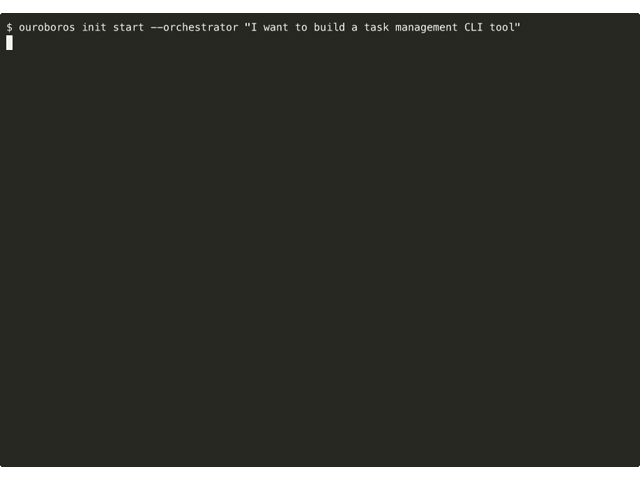
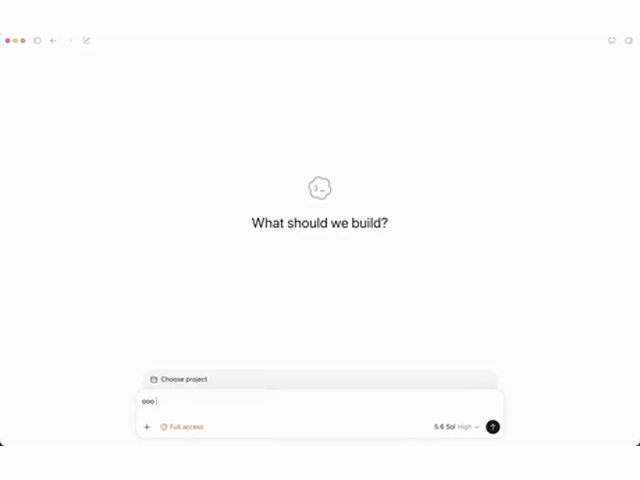
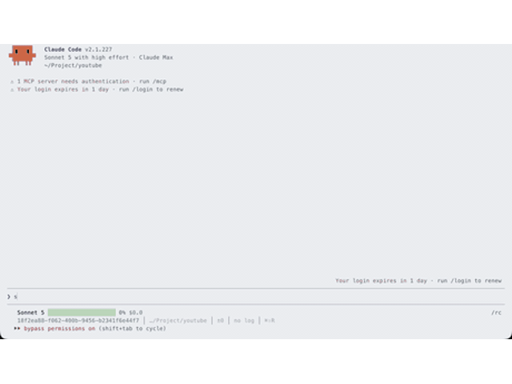
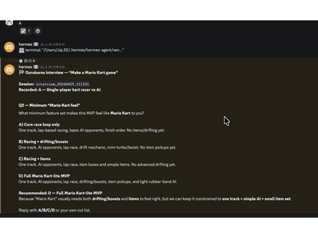
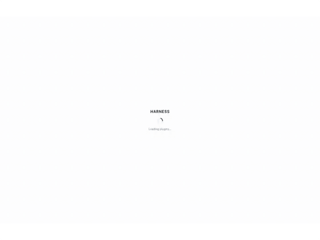
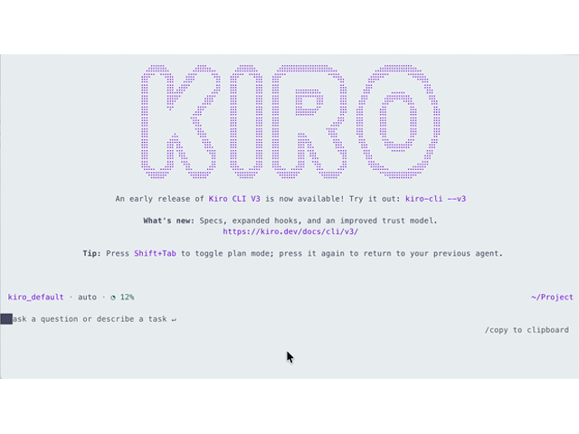
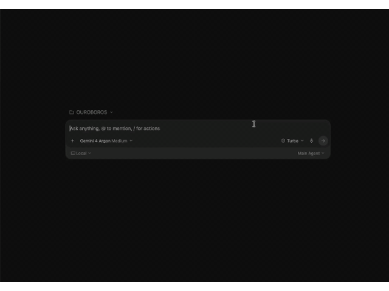

# How Ouroboros Works

> **It gets smarter on its own. We just hold the line.**
>
> Skip the prompt engineering. The agent runs, fails, and gets smarter every
> generation. The grading command and expected result never make it into the
> success contract we hand it.

This page holds the background that used to live in the main README: why
Ouroboros exists, the loop it runs, the agents behind it, how it is built, and
the ideas it comes from. To install it and try it, start with the
[README](../README.md) or the [Getting Started guide](./getting-started.md).

Ouroboros is an **Agent OS** for AI coding: a local-first runtime layer that
turns non-deterministic agent work into a replayable, observable, policy-bound
execution contract. It replaces ad-hoc prompting with a structured
specification-first workflow: interview, crystallize, execute, evaluate,
evolve.

- [See it on each host](#see-it-on-each-host)
- [Why Ouroboros?](#why-ouroboros)
- [What you get](#what-you-get)
- [How it compares](#how-it-compares)
- [The loop](#the-loop)
- [The nine minds](#the-nine-minds)
- [The Ouroboros Agent OS stack](#the-ouroboros-agent-os-stack)
- [Under the hood](#under-the-hood)
- [From wonder to ontology](#from-wonder-to-ontology)

---

## See it on each host

Seven separate runs on seven hosts. The tasks differ on purpose: what the hosts
share is the engine, not the prompt.

<table>
<tr>
<td align="center" valign="top" width="50%"><br><sub><b>Terminal CLI</b> — a task-management CLI: <code>ouroboros init start</code> asking about ordering and scope, then reporting an ambiguity score</sub></td>
<td align="center" valign="top" width="50%"><br><sub><b>ChatGPT (Codex)</b> — called as an integration, on a video-publishing harness: the interview, its advisory lanes, and the ambiguity ledger</sub></td>
</tr>
<tr>
<td align="center" valign="top" width="50%"><br><sub><b>Claude Code</b> — a YouTube automation task, with the six advisory lanes running in parallel before the interview submits</sub></td>
<td align="center" valign="top" width="50%"><br><sub><b>Hermes (Discord)</b> — a kart-racing game, run as a chat bot, ending at <code>Final ambiguity: 0.15</code></sub></td>
</tr>
<tr>
<td align="center" valign="top" width="50%"><br><sub><b>DeepSeek Harness</b> — an OSS-trend outreach script, driven from a dsh chat: <code>mcp__ouroboros__ouroboros_interview</code> turn by turn, fan-out results submitted between rounds</sub></td>
<td align="center" valign="top" width="50%"><br><sub><b>Kiro</b> — the Kiro CLI running the Ouroboros interview flow, turning a vague request into a structured, testable Seed</sub></td>
</tr>
<tr>
<td align="center" valign="top" colspan="2"><br><sub><b>Antigravity</b> — a YouTube-publishing automation interview: asks what to automate, shows advisory lanes, and submits the selected answer</sub></td>
</tr>
</table>

Setup instructions for each host are in the [runtime guides](./README.md#runtime-guides)
and in [Getting Started](./getting-started.md#choosing-a-runtime-backend).

---

## Why Ouroboros?

Most AI coding fails at the **input**, not the output. The bottleneck is not AI capability -- it is human clarity.

| Problem       | What Happens                     | Ouroboros Fix                                 |
| :------------ | :------------------------------- | :-------------------------------------------- |
| Vague prompts | AI guesses, you rework           | Socratic interview exposes hidden assumptions |
| No spec       | Architecture drifts mid-build    | Immutable seed spec locks intent before code  |
| Manual QA     | "Looks good" is not verification | 3-stage automated evaluation gate             |

---

## What you get

After one loop of the Ouroboros cycle, a vague idea becomes a verified codebase:

| Step          | Before                  | After                                                                   |
| :------------ | :---------------------- | :---------------------------------------------------------------------- |
| **Interview** | *"Build me a task CLI"* | 12 hidden assumptions exposed, ambiguity scored to 0.19                 |
| **Seed**      | No spec                 | Immutable specification with acceptance criteria, ontology, constraints |
| **Evaluate**  | Manual review           | 3-stage gate: Mechanical (free) -> Semantic -> Multi-Model Consensus    |

What just happened:

```
interview  ->  Socratic questioning exposed 12 hidden assumptions
seed       ->  Crystallized answers into an immutable spec (Ambiguity: 0.15)
run        ->  Fanned acceptance criteria out to agents in dependency order
evaluate   ->  3-stage verification: Mechanical -> Semantic -> Consensus
```

> Use `ooo <cmd>` inside your AI coding agent session, or `ouroboros init start`, `ouroboros run seed.yaml`, etc. from the terminal.

The serpent completed one loop. Each loop, it knows more than the last.

---

## How it compares

AI coding tools are powerful -- but they solve the **wrong problem** when the input is unclear.

|                     | Vanilla AI Coding                        | Ouroboros                                                                       |
| :------------------ | :--------------------------------------- | :------------------------------------------------------------------------------ |
| **Vague prompt**    | AI guesses intent, builds on assumptions | Socratic interview forces clarity *before* code                                 |
| **Spec validation** | No spec -- architecture drifts mid-build | Immutable seed spec locks intent; ambiguity gate (<= 0.2) blocks premature code without explicit `force` |
| **Evaluation**      | "Looks good" / manual QA                 | 3-stage automated gate: Mechanical -> Semantic -> Multi-Model Consensus         |
| **Rework rate**     | High -- wrong assumptions surface late   | Low -- assumptions surface in the interview, not in the PR review               |

---

## The loop

The ouroboros -- a serpent devouring its own tail -- is not decoration. It IS the architecture:

```
    Interview -> Seed -> Execute -> Evaluate
        ^                           |
        +---- Evolutionary Loop ----+
```

Each cycle does not repeat -- it **evolves**. The output of evaluation feeds back as input for the next generation, until the system truly knows what it is building.

| Phase         | What Happens                                                          |
| :------------ | :-------------------------------------------------------------------- |
| **Interview** | Socratic questioning exposes hidden assumptions                       |
| **Seed**      | Answers crystallize into an immutable specification                   |
| **Execute**   | Acceptance criteria fan out to agents in dependency order             |
| **Evaluate**  | 3-stage gate: Mechanical ($0) -> Semantic -> Multi-Model Consensus    |
| **Evolve**    | Wonder *("What do we still not know?")* -> Reflect -> next generation |

> *"This is where the Ouroboros eats its tail: the output of evaluation*
> *becomes the input for the next generation's seed specification."*
> -- `reflect.py`

Convergence is reached when ontology similarity >= 0.95 -- when the system has
questioned itself into clarity. `ooo ralph` keeps the loop going across session
boundaries until it converges; every generation is recorded in the EventStore,
so the lineage can be inspected and continued after a restart.

The [Evolutionary Loop & Ralph guide](./guides/evolution-loop.md) covers the
Wonder and Reflect engines, the similarity formula, every termination signal,
Ralph versus `ooo evolve`, and the configuration keys. The three-stage gate is
in the [Evaluation Pipeline guide](./guides/evaluation-pipeline.md).

---

## The nine minds

Nine highlighted agents below; the full set of bundled agents is in
[`src/ouroboros/agents/`](../src/ouroboros/agents/). All are loaded on demand,
never preloaded:

| Agent                    | Role                               | Core Question                                       |
| :----------------------- | :--------------------------------- | :-------------------------------------------------- |
| **Socratic Interviewer** | Questions-only. Never builds.      | *"What are you assuming?"*                          |
| **Ontologist**           | Finds essence, not symptoms        | *"What IS this, really?"*                           |
| **Seed Architect**       | Crystallizes specs from dialogue   | *"Is this complete and unambiguous?"*               |
| **Evaluator**            | 3-stage verification               | *"Did we build the right thing?"*                   |
| **Contrarian**           | Challenges every assumption        | *"What if the opposite were true?"*                 |
| **Hacker**               | Finds unconventional paths         | *"What constraints are actually real?"*             |
| **Simplifier**           | Removes complexity                 | *"What's the simplest thing that could work?"*      |
| **Researcher**           | Stops coding, starts investigating | *"What evidence do we actually have?"*              |
| **Architect**            | Identifies structural causes       | *"If we started over, would we build it this way?"* |

---

## The Ouroboros Agent OS stack

Like any OS, Ouroboros is split into a stable **OS layer** of primitives, an
**application layer** of domain workflows, and a **shell** that humans actually
sit in front of. Three repos, one stack:

| Layer | Repo | Role | What it gives you |
| :--- | :--- | :--- | :--- |
| **Shell** (terminal client) | [`Ouro-labs/ourocode`](https://github.com/Ouro-labs/ourocode) | Native terminal UI for running `ooo` workflows across Claude / Codex / Gemini CLIs in one session | TUI, wonderTool decision pickers, MCP pane state, command discovery |
| **Apps** (domain workflows) | [`Ouro-labs/ouroboros-plugins`](https://github.com/Ouro-labs/ouroboros-plugins) | UserLevel plugin contract — composes core primitives into installable domain programs (PR ops, Jira sync, incidents, releases) | Plugin manifest, scoped permissions, audit/provenance, reference plugins |
| **OS** (this repo) | [`Q00/ouroboros`](https://github.com/Q00/ouroboros) | Agent OS core — Seed, Ledger, Runtime, MCP, safety boundaries | `ooo` commands, spec-first workflow engine, multi-runtime adapter |

**How they connect:**

```
  ourocode  ──►  ooo / ouroboros-plugins  ──►  ouroboros core (Seed · Ledger · MCP · Runtime)
   shell             user-level apps                        kernel
```

- The **kernel** (`ouroboros`) owns the contract: every action becomes a
  Seed-bound, ledger-recorded, replayable event — regardless of which LLM
  executes it.
- **Plugins** (`ouroboros-plugins`) declare scoped capabilities against that
  contract, so domain workflows (review a PR, triage a Linear ticket, run a
  release) stay auditable and policy-bound instead of being one-off prompts.
- **Ourocode** is the terminal shell: it surfaces MCP state, interview
  questions, and wonderTool decisions as first-class TUI elements, so you can
  drive the OS without leaving the keyboard or switching between CLIs.

Use `ouroboros` alone with any supported CLI, layer plugins on for domain
workflows, or install `ourocode` when you want a unified terminal cockpit.

---

## Under the hood

Architecture overview -- Python >= 3.12.

Exact file counts come from the current checkout:
`git ls-files ':(glob)src/ouroboros/**/*.py'` and
`git ls-files ':(glob)tests/**/test_*.py'`. The `src/ouroboros/_version.py`
file that Hatch-VCS writes at build time is not part of the tracked source
inventory.

```
src/ouroboros/
+-- bigbang/        Interview, ambiguity scoring, brownfield explorer
+-- router/         Skill dispatch (`ooo <skill>` -> MCP tool); PAL tier routing is in orchestrator/
+-- execution/      (deprecated — logic moved to orchestrator/ and mcp/tools/)
+-- evaluation/     Mechanical -> Semantic -> Multi-Model Consensus
+-- evolution/      Wonder / Reflect cycle, convergence detection
+-- resilience/     4-pattern stagnation detection, 5 lateral personas
+-- observability/  3-component drift measurement, auto-retrospective
+-- persistence/    Event sourcing (SQLAlchemy + aiosqlite), checkpoints
+-- orchestrator/   Runtime abstraction layer (Claude Code, Codex CLI, OpenCode, Hermes, Gemini, Kiro, Copilot, Pi, OMP, GJC, Goose, Antigravity, Grok, Zcode)
+-- core/           Types, errors, seed, ontology, security
+-- providers/      LiteLLM adapter (100+ models)
+-- mcp/            MCP client/server integration
+-- plugin/         Plugin system (skill/agent auto-discovery)
+-- tui/            Terminal UI dashboard
+-- cli/            Typer-based CLI
```

**Key internals:**
- **PAL Router** -- Frugal (1x) -> Standard (10x) -> Frontier (30x) with escalation on retry (no automatic downgrade)
- **Drift** -- Goal (50%) + Constraint (30%) + Ontology (20%) weighted measurement, threshold <= 0.3
- **Brownfield** -- Auto-detects config files across multiple language ecosystems
- **Evolution** -- Up to 30 generations, convergence at ontology similarity >= 0.95
- **Stagnation** -- Detects spinning, oscillation, no-drift, and diminishing returns patterns
- **Agent OS runtime** -- Replayable execution contract across capability discovery, policy, directives, event journal, and agent processes
- **Runtime backends** -- Pluggable abstraction layer (`orchestrator.runtime_backend` config) with first-class support for every canonical backend returned by `runtime_backend_choices()`, including GJC, Antigravity, Grok, and Zcode; same workflow spec, different execution engines

See [Architecture](./architecture.md) for the full design document and
[Architecture for Contributors](./contributing/architecture-overview.md) for how
the modules connect.

---

## From wonder to ontology

The philosophical engine behind Ouroboros.

> *Wonder -> "How should I live?" -> "What IS 'live'?" -> Ontology*
> -- Socrates

Every great question leads to a deeper question -- and that deeper question is always **ontological**: not *"how do I do this?"* but *"what IS this, really?"*

```
   Wonder                          Ontology
"What do I want?"    ->    "What IS the thing I want?"
"Build a task CLI"   ->    "What IS a task? What IS priority?"
"Fix the auth bug"   ->    "Is this the root cause, or a symptom?"
```

This is not abstraction for its own sake. When you answer *"What IS a task?"* -- deletable or archivable? solo or team? -- you eliminate an entire class of rework. **The ontological question is the most practical question.**

Ouroboros embeds this into its architecture through the **Double Diamond**:

```
    * Wonder          * Design
   /  (diverge)      /  (diverge)
  /    explore      /    create
 /                 /
* ------------ * ------------ *
 \                 \
  \    define       \    deliver
   \  (converge)     \  (converge)
    * Ontology        * Evaluation
```

The first diamond is **Socratic**: diverge into questions, converge into ontological clarity. The second diamond is **pragmatic**: diverge into design options, converge into verified delivery. Each diamond requires the one before it -- you cannot design what you have not understood.

### Ambiguity score: the gate between wonder and code

The Interview does not end when you feel ready -- it ends when the **math** says you are ready. Ouroboros quantifies ambiguity as the inverse of weighted clarity:

```
Ambiguity = 1 - Sum(clarity_i * weight_i)
```

Each dimension is scored 0.0-1.0 by the LLM (temperature 0.1 for reproducibility), then weighted:

| Dimension                                                     | Greenfield | Brownfield |
| :------------------------------------------------------------ | :--------: | :--------: |
| **Goal Clarity** -- *Is the goal specific?*                   |    40%     |    35%     |
| **Constraint Clarity** -- *Are limitations defined?*          |    30%     |    25%     |
| **Success Criteria** -- *Are outcomes measurable?*            |    30%     |    25%     |
| **Context Clarity** -- *Is the existing codebase understood?* |     --     |    15%     |

**Threshold: Ambiguity <= 0.2.** A score above that blocks Seed generation. Passing `force` explicitly is what gets past it, and the CLI puts that choice on screen next to continue and cancel. The gate is a default worth arguing with, not a lock.

```
Example (Greenfield):

  Goal: 0.9 * 0.4  = 0.36
  Constraint: 0.8 * 0.3  = 0.24
  Success: 0.7 * 0.3  = 0.21
                        ------
  Clarity             = 0.81
  Ambiguity = 1 - 0.81 = 0.19  <= 0.2 -> Ready for Seed
```

Why 0.2? Because at 80% weighted clarity, the remaining unknowns are small enough that code-level decisions can resolve them. Above that threshold, you are still guessing at architecture.

### Ontology convergence: when the serpent stops

The evolutionary loop does not run forever. It stops when consecutive
generations produce ontologically identical schemas (similarity >= 0.95), or
when it detects stagnation, oscillation, repetitive Wonder questions, or the
30-generation hard cap. The formula and every signal are in
[Convergence: When the Serpent Stops](./guides/evolution-loop.md#convergence-when-the-serpent-stops).

Two mathematical gates, one philosophy: **do not build until you are clear (Ambiguity <= 0.2), do not stop evolving until you are stable (Similarity >= 0.95).**
